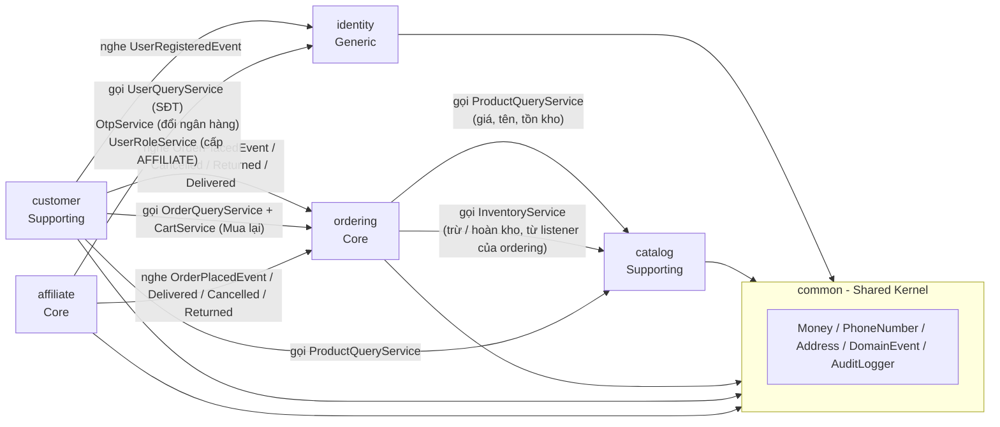
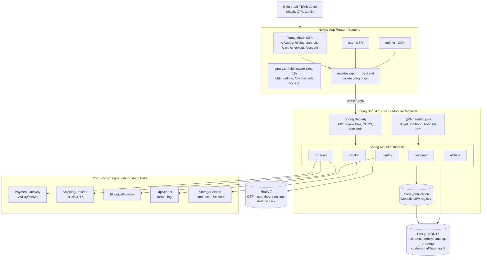

# 01 – Thiết kế hệ thống

> Bản demo website bán thực phẩm chế biến có chương trình cộng tác viên (CTV / affiliate).
> Kiến trúc: **Modular Monolith theo DDD** (Spring Boot 4.1 + Spring Modulith) + **Next.js App Router**.

---

## 1. Tổng quan

| Hạng mục | Nội dung |
|---|---|
| Sản phẩm | Thực phẩm qua chế biến, **không có biến thể** (1 sản phẩm = 1 giá) |
| Kênh bán | Website là kênh riêng, chưa đồng bộ Facebook / TikTok / Zalo / Shopee |
| Nguồn khách chính | CTV chia sẻ link lên mạng xã hội → khách mở bằng điện thoại → **mobile-first** |
| Tài khoản | Bắt buộc khi mua, nhưng **tạo ngay trong bước thanh toán** (SĐT → OTP), không có trang đăng ký riêng |
| Hoa hồng | 10% trên (subtotal − discount), 1 cấp, gắn khách vĩnh viễn (first-touch) |
| Thời gian | Demo chạy được trong 3 ngày, 1 người làm |

### 1.1 Phạm vi demo

**Trong phạm vi**

- Web khách: trang chủ, danh mục, chi tiết sản phẩm, tìm kiếm không dấu, giỏ hàng, thanh toán kèm OTP, trang cảm ơn kèm QR, tài khoản (đơn của tôi, Mua lại, địa chỉ).
- Trang CTV `/ctv`: đăng ký, dashboard, thông tin ngân hàng, yêu cầu rút tiền.
- Trang admin `/admin`: danh mục, sản phẩm, đơn hàng, khách hàng (lọc + CSV), duyệt CTV, duyệt / chi trả rút tiền.
- Thanh toán: **COD** và **BANK_QR** (ảnh VietQR, admin xác nhận đã nhận tiền).
- Thu thập thông tin xuất hóa đơn VAT (không phát hành hóa đơn thật).

**Ngoài phạm vi (chỉ để sẵn port + implementation giả)**

VNPay/MoMo thật, GHN/GHTK thật, hóa đơn điện tử thật, SMS/Zalo OTP thật, video theo danh mục, Flash Sale, tích điểm, voucher (field `discount` luôn = 0 trong demo), tách microservice, message broker.

### 1.2 Vai trò người dùng

| Vai trò | Cách đăng nhập | Quyền chính |
|---|---|---|
| Khách vãng lai (anonymous) | – | Xem sản phẩm, giỏ hàng localStorage, click link CTV |
| `CUSTOMER` | SĐT + OTP | Đặt hàng, xem đơn của mình, Mua lại, quản lý địa chỉ |
| `AFFILIATE` | SĐT + OTP (cùng tài khoản) | Dashboard CTV, link giới thiệu, thông tin ngân hàng, rút tiền |
| `ADMIN` | Email + mật khẩu (BCrypt) | Toàn quyền quản trị |

Một user có thể **vừa là CUSTOMER vừa là AFFILIATE** (`user_roles` là quan hệ nhiều-nhiều). Mọi user đăng nhập bằng OTP đều có `CUSTOMER`; `AFFILIATE` được cấp khi hồ sơ CTV được duyệt.

---

## 2. Bounded context

| Module | Loại | Trách nhiệm | Aggregate root |
|---|---|---|---|
| `affiliate` | **Core** | Hồ sơ CTV, mã giới thiệu, ghi nhận click, gắn khách vĩnh viễn, tính hoa hồng, rút tiền, audit tiền | `Affiliate`, `CustomerBinding`, `ReferralClick`, `Commission`, `Payout` |
| `ordering` | **Core** | Giỏ hàng, đặt hàng, tính giá ở backend, vòng đời đơn, thanh toán COD/QR, phí ship, thông tin VAT | `Cart`, `Order` |
| `catalog` | Supporting | Danh mục, sản phẩm, thông tin thực phẩm, tìm kiếm, tồn kho | `Category`, `Product` |
| `customer` | Supporting | Hồ sơ khách, sổ địa chỉ, thống kê (read model), phân nhóm khách, Mua lại, sản phẩm hay mua | `Customer` |
| `identity` | Generic | User, vai trò, OTP, JWT + refresh token xoay vòng, đăng nhập admin | `UserAccount`, `RefreshToken` |
| `common` | Shared kernel | `Money`, `PhoneNumber`, `Address`, base `DomainEvent`, `DomainException`, security, config, `AuditLogger`, rate limiter | – |

> **Lý do**: affiliate là khác biệt cạnh tranh (khách mua chủ yếu qua CTV) và ordering là nguồn doanh thu → core. Catalog/customer cần nhưng không khác biệt → supporting. Identity là bài toán chung → generic (sau này có thể thay bằng Keycloak/Cognito).

---

## 3. Context map

### 3.1 Quy tắc hướng phụ thuộc (quan trọng)

Spring Modulith `verify()` **cấm phụ thuộc vòng** giữa các module. "Nghe event của module X" cũng là phụ thuộc vào X (phải import class event). Do đó chốt một **thứ tự phụ thuộc một chiều**:

```
common  ←  identity  ←  catalog  ←  ordering  ←  customer
                ↑                       ↑
                └──────── affiliate ────┘
```

- Module **phía dưới (downstream)** được phép: gọi service public của module phía trên **và** nghe event của module phía trên.
- Module **phía trên (upstream)** không bao giờ biết module phía dưới.
- Khi upstream cần "phản ứng" với downstream (ví dụ catalog phải trừ kho khi ordering đặt hàng, identity phải cấp role khi CTV được duyệt), ta đặt **listener ở downstream**: nó nghe chính event của module mình rồi gọi service public của upstream, **trong một transaction riêng** (sau commit, async). Như vậy mỗi transaction vẫn chỉ sửa 1 aggregate và không có vòng.

### 3.2 Sơ đồ context map



<details>
<summary>Mã nguồn Mermaid</summary>



</details>

| Upstream → Downstream | Kiểu quan hệ | Cơ chế |
|---|---|---|
| catalog → ordering | Customer/Supplier | ordering gọi `ProductQueryService`, `InventoryService` |
| ordering → customer | Published Language (event) + Open Host | customer nghe `OrderPlacedEvent…`, gọi `OrderQueryService`, `CartService` |
| ordering → affiliate | Published Language (event) | affiliate nghe `OrderPlacedEvent`, `OrderDeliveredEvent`, `OrderCancelledEvent`, `OrderReturnedEvent` |
| identity → customer | Published Language (event) | customer nghe `UserRegisteredEvent` để tạo `Customer` |
| identity → affiliate | Open Host Service | affiliate gọi `UserQueryService`, `OtpService`, `UserRoleService` |
| catalog → customer | Open Host Service | customer gọi `ProductQueryService` (Mua lại, sản phẩm hay mua) |

---

## 4. Kiến trúc tổng thể



<details>
<summary>Mã nguồn Mermaid</summary>



</details>

**Quyết định chính**

- **Next.js rewrites `/api/*` sang Spring Boot** → trình duyệt chỉ thấy 1 origin, cookie JWT HttpOnly + SameSite=Lax hoạt động không cần cấu hình cross-site. CORS vẫn bật, chỉ cho `FRONTEND_ORIGIN`. Trang SSR gọi backend trực tiếp qua `BACKEND_INTERNAL_URL` (chuyển tiếp cookie).
- **Event nội bộ** dùng `ApplicationEventPublisher` + `@ApplicationModuleListener` (async, chạy sau commit, transaction mới). Spring Modulith **Event Publication Registry (JPA)** lưu event chưa xử lý xong để retry khi khởi động lại → không mất event khi listener lỗi. Khi tách microservice chỉ cần externalize event (`@Externalized`) ra Kafka/RabbitMQ.
- **Mỗi module một schema PostgreSQL**, không FK xuyên schema. Bảng `event_publication` đặt ở schema `public`. Bảng `audit_logs` thuộc schema `audit` do `common` quản lý.
- **Flyway** một lần chạy, script đặt theo module: `db/migration/{common,identity,catalog,ordering,customer,affiliate}`.

---

## 5. Cây package backend

Package-by-module (module trước, tầng sau). Mỗi module **chỉ có 4 thư mục chính**: `api`, `service`, `entity`, `repository`.

```text
com.vietnl.hwin
├── HwinApplication.java
├── common/                                  # Shared kernel – @ApplicationModule(type = OPEN)
│   ├── package-info.java
│   ├── config/          JpaConfig, AsyncConfig, SchedulingConfig, OpenApiConfig, CorsProperties, RedisConfig
│   ├── security/        SecurityConfig, JwtService, JwtCookieAuthFilter, CookieFactory, CurrentUser, AuthPrincipal
│   ├── exception/       DomainException, NotFoundException, ForbiddenException, GlobalExceptionHandler, ErrorResponse
│   ├── domain/          Money, PhoneNumber, Address, DomainEvent, AggregateRoot, BaseEntity
│   ├── audit/           AuditLogger, AuditLogEntry (schema audit, chỉ INSERT)
│   ├── ratelimit/       RateLimiter (Redis INCR + EXPIRE)
│   └── util/            PhoneMasker, SlugUtils, TextNormalizer
│
├── identity/
│   ├── api/             AuthController, AdminAuthController
│   │   ├── dto/         AuthDtos (SendOtpRequest, VerifyOtpRequest, AdminLoginRequest, MeResponse)
│   │   └── mapper/      UserMapper
│   ├── service/         AuthService, UserAccountService, OtpService*, TokenService, UserQueryService*, UserRoleService*,
│   │   │                OtpProperties, AdminSeeder
│   │   └── integration/ OtpSender (port), LogOtpSender (dev)
│   ├── entity/          UserAccount, RefreshToken, Role, UserStatus, OtpPurpose, UserRegisteredEvent*  (event)
│   └── repository/      UserAccountRepository, RefreshTokenRepository
│
├── catalog/
│   ├── api/             CategoryController, ProductController, AdminCategoryController, AdminProductController (kèm upload)
│   │   ├── dto/         CatalogDtos (CategoryResponse, ProductCardResponse, ProductDetailResponse, SaveProductRequest, …)
│   │   └── mapper/      ProductMapper
│   ├── service/         CategoryService, ProductAdminService, ProductSearchService, ProductQueryService*, ProductSnapshot*,
│   │   │                InventoryService* (Chặng 2)
│   │   └── integration/ StorageService (port), LocalStorageService
│   ├── entity/          Category, Product, ProductImage, ProductDetails (VO), FoodInfo (@Embeddable), ProductSort,
│   │                StockMovement, StockMovementType (Chặng 2)
│   └── repository/      CategoryRepository, ProductRepository
│
├── ordering/
│   ├── api/             CartController, CheckoutController, OrderController, AdminOrderController
│   │   ├── dto/         CartResponse, AddCartItemRequest, MergeCartRequest, PlaceOrderRequest, OrderResponse, …
│   │   └── mapper/      CartMapper, OrderMapper
│   ├── service/         CartService*, PlaceOrderService, OrderAdminService, OrderQueryService*,
│   │   │                OrderStockEventListener, CartClearEventListener, OrderAutoCompleteJob, PricingPolicy, OrderCodeGenerator
│   │   └── integration/ PaymentGateway, FakePaymentGateway, VietQrService, ShippingProvider, FakeShippingProvider,
│   │                    EInvoiceProvider, FakeEInvoiceProvider
│   ├── entity/          Cart, CartItem, Order, OrderItem, ShippingAddress (@Embeddable), VatInvoiceInfo (@Embeddable),
│   │                    OrderStatus, PaymentMethod, PaymentStatus, CancelReason,
│   │                    OrderPlacedEvent*, OrderConfirmedEvent*, OrderDeliveredEvent*, OrderCancelledEvent*, OrderReturnedEvent*, OrderCompletedEvent*
│   └── repository/      CartRepository, OrderRepository
│
├── customer/
│   ├── api/             MyProfileController, MyAddressController, ReorderController, AdminCustomerController
│   │   ├── dto/         ProfileResponse, SaveAddressRequest, ShippingAddressResponse, ReorderResponse, CustomerRowResponse, …
│   │   └── mapper/      CustomerMapper
│   ├── service/         CustomerService, AddressService, ReorderService, CustomerStatsEventListener,
│   │                    CustomerProvisioningEventListener, FavoriteProductService, CustomerSegmentPolicy, CustomerCsvExporter
│   ├── entity/          Customer, CustomerAddress, CustomerStats (read model), CustomerProductStat (read model), CustomerSegment
│   └── repository/      CustomerRepository, CustomerStatsRepository*, CustomerProductStatRepository*
│
└── affiliate/
    ├── api/             AffiliateController, ReferralClickController, PayoutController, AdminAffiliateController, AdminPayoutController
    │   ├── dto/         AffiliateRegisterRequest, DashboardResponse, UpdateBankAccountRequest, CreatePayoutRequest, …
    │   └── mapper/      AffiliateMapper, CommissionMapper, PayoutMapper
    ├── service/         AffiliateService, ReferralClickService, AttributionService, CommissionService,
    │   │                CommissionApprovalJob, PayoutService, BalanceCalculator, OrderCommissionEventListener,
    │   │                AffiliateRoleEventListener, BankAccountCrypto (AES-GCM)
    │   └── integration/ (trống – để dành cổng chuyển khoản tự động)
    ├── entity/          Affiliate, ReferralCode (VO), BankAccount (@Embeddable, mã hóa), CustomerBinding, ReferralClick,
    │                    Commission, Payout, AffiliateStatus, CommissionStatus, PayoutStatus,
    │                    AffiliateApprovedEvent*, CommissionApproved, PayoutPaid
    └── repository/      AffiliateRepository, CustomerBindingRepository, ReferralClickRepository,
                         CommissionRepository, PayoutRepository
```

`*` = kiểu **công bố cho module khác** (đánh dấu `@NamedInterface` ở mức class). Theo mặc định Spring Modulith coi mọi sub-package là nội bộ; chỉ những class gắn `@NamedInterface` (service public + domain event) mới được module khác import. `CustomerStats`/`CustomerProductStat` là read model nên có repository riêng (ngoại lệ có chủ đích cho quy tắc "repository chỉ cho aggregate root").

---

## 6. Domain events

Tất cả event là `record` bất biến, kế thừa `DomainEvent` (`eventId`, `occurredAt`), chỉ chứa ID và giá trị snapshot – không chứa entity.

| Event | Module phát | Payload chính | Module nghe | Hành động |
|---|---|---|---|---|
| `UserRegisteredEvent` | identity | userId, phone | customer | Tạo `Customer` (id = userId) + `CustomerStats` rỗng |
| `OrderPlacedEvent` | ordering | orderId, orderCode, customerId, referralCode?, items[productId, name, qty, unitPrice], subtotal, discount, shippingFee, total, placedAt | ordering (`OrderStockEventListener`) | Gọi `catalog.InventoryService.deduct()`; thiếu hàng → `order.cancel(OUT_OF_STOCK)` |
| | | | affiliate | Xác định CTV (binding cũ hoặc tạo binding mới từ ref), chặn tự giới thiệu, tạo `Commission` PENDING |
| | | | customer | +1 đơn, +tổng chi tiêu, cập nhật `lastOrderAt`, cộng `CustomerProductStat` |
| `OrderConfirmedEvent` | ordering | orderId, confirmedAt | (chưa có) | Để sẵn cho ShippingProvider |
| `OrderDeliveredEvent` | ordering | orderId, deliveredAt | affiliate | `commission.markEligible(deliveredAt + holdDays)` |
| `OrderCancelledEvent` | ordering | orderId, customerId, total, reason | ordering (`OrderStockEventListener`) | `InventoryService.restore()` (chỉ khi đã trừ) |
| | | | affiliate | `commission.cancel()` |
| | | | customer | −1 đơn, −tổng chi tiêu, trừ `CustomerProductStat` |
| `OrderReturnedEvent` | ordering | orderId, customerId, total | như `OrderCancelledEvent` | Hoàn kho, hủy hoa hồng, trừ thống kê |
| `OrderCompletedEvent` | ordering | orderId | (chưa có) | Hết hạn đổi trả |
| `AffiliateApprovedEvent` | affiliate | affiliateId, userId | affiliate (`AffiliateRoleEventListener`) | Gọi `identity.UserRoleService.grant(userId, AFFILIATE)` |
| `AffiliateSuspendedEvent` | affiliate | affiliateId, userId | affiliate | Gỡ role `AFFILIATE` (link ngừng hoạt động) |
| `CommissionApproved` | affiliate | commissionId, affiliateId, amount | (nội bộ) | Ghi audit |
| `PayoutPaid` | affiliate | payoutId, amount, txnRef | (nội bộ) | Ghi audit |

---

## 7. Quy tắc nghiệp vụ trọng yếu (tham chiếu nhanh)

| Quy tắc | Đặt ở đâu |
|---|---|
| Giá luôn tính ở backend từ `ProductQueryService`, không tin client | `PlaceOrderService` + `Order.place()` |
| `total = subtotal − discount + shippingFee`; `Money` không âm | `Order`, `Money` |
| Phí ship cố định `hwin.ordering.shipping-fee` (mặc định 30.000đ) | `PricingPolicy` |
| Hủy chỉ trước `SHIPPING`; trả hàng chỉ khi `DELIVERED` và trong `return-window-days` (7) | `Order.cancel()`, `Order.markReturned()` |
| Đơn BANK_QR phải `PAID` trước khi `CONFIRMED`; COD tự `PAID` khi `DELIVERED` | `Order.confirm()`, `Order.markDelivered()` |
| Hoa hồng = 10% × (subtotal − discount), làm tròn xuống đồng | `Commission.create()` |
| Gắn khách vĩnh viễn: `customer_bindings.customer_id` UNIQUE | `CustomerBinding`, `AttributionService` |
| Chống tự giới thiệu: SĐT khách = SĐT CTV → không binding, không hoa hồng | `AttributionService` (dùng `PhoneNumber.equals`) |
| Chỉ CTV `APPROVED` có link hoạt động và nhận hoa hồng mới | `Affiliate.canEarn()` |
| Số dư khả dụng = Σ hoa hồng APPROVED − Σ payout (REQUESTED, APPROVED, PAID) | `BalanceCalculator` |
| Rút tối thiểu 200.000đ; mỗi CTV tối đa 1 payout đang mở; khóa 48h sau đổi ngân hàng | `Payout.request()`, `Affiliate.assertCanWithdraw()` |
| Thay đổi liên quan tới tiền → `audit.audit_logs` (chỉ INSERT, trigger chặn UPDATE/DELETE) | `AuditLogger` |

### Cấu hình (application.yml)

```yaml
hwin:
  cors-origins: ${FRONTEND_ORIGIN:http://localhost:3100}   # nằm trong hwin.security
  security:
    jwt-secret: ${JWT_SECRET}
    access-token-ttl: 15m
    refresh-token-ttl: 7d
    cookie-secure: ${COOKIE_SECURE:true}   # dev http://localhost có thể đặt false
  otp:
    ttl: 5m
    max-attempts: 5
    lock-duration: 15m
    send-limit: 3
    send-window: 10m
  ordering:
    shipping-fee: 30000
    return-window-days: 7
    place-order-limit: 5          # số đơn / 10 phút / user
    bank-qr:
      bank-bin: ${BANK_QR_BIN:970436}
      account-no: ${BANK_QR_ACCOUNT}
      account-name: ${BANK_QR_NAME}
  customer:
    loyal-min-orders: 3
    dormant-days: 60
    new-days: 30
  affiliate:
    commission-rate: 0.10
    hold-days: 7
    min-payout: 200000
    ref-cookie-days: 30
    click-dedupe-hours: 24
    bank-change-lock-hours: 48
    bank-encryption-key: ${AFFILIATE_BANK_KEY}   # base64 32 byte
  admin-seed:
    email: ${ADMIN_EMAIL}
    password: ${ADMIN_PASSWORD}
```

---

## 8. Bảng thuật ngữ (Ubiquitous Language)

| Tiếng Việt | Tiếng Anh (code / bảng / API) | Ghi chú |
|---|---|---|
| Người dùng / tài khoản | `UserAccount` / `user_accounts` | Thuộc identity |
| Vai trò | `Role` (`CUSTOMER`, `AFFILIATE`, `ADMIN`) | |
| Mã OTP | `Otp` | 6 chữ số, lưu hash trong Redis |
| Mã làm mới | `RefreshToken` | Xoay vòng, lưu hash trong DB |
| Danh mục | `Category` | |
| Sản phẩm | `Product` | Không có biến thể |
| Giá bán / giá gốc | `price` / `compareAtPrice` | Giá gốc để gạch ngang |
| Nhà sản xuất | `manufacturer` | |
| Hạn sử dụng (thời hạn) | `shelfLife` | VD "12 tháng kể từ NSX" |
| Hướng dẫn bảo quản | `storageInstructions` | |
| Số công bố sản phẩm | `declarationNumber` | |
| Giấy chứng nhận ATTP | `foodSafetyCertificate` | Số + ảnh |
| Tồn kho | `stock` | |
| Biến động kho | `StockMovement` (`DEDUCT`, `RESTORE`) | Idempotent theo orderId |
| Sản phẩm bán chạy | `bestseller` | Cờ |
| Giỏ hàng / dòng giỏ | `Cart` / `CartItem` | |
| Đơn hàng / dòng đơn | `Order` / `OrderItem` | Mã hiển thị `orderCode` |
| Tạm tính | `subtotal` | Σ đơn giá × SL |
| Giảm giá | `discount` | Demo = 0 |
| Phí vận chuyển | `shippingFee` | |
| Tổng thanh toán | `total` | |
| Địa chỉ giao hàng | `ShippingAddress` | Snapshot trong đơn |
| Thông tin xuất hóa đơn VAT | `VatInvoiceInfo` | companyName, taxCode, address, email |
| Thanh toán khi nhận hàng | `COD` | |
| Chuyển khoản QR | `BANK_QR` | VietQR |
| Khách hàng | `Customer` | id = userId |
| Sổ địa chỉ | `CustomerAddress` | Có địa chỉ mặc định |
| Mua lại | `Reorder` | |
| Sản phẩm bạn hay mua | `FavoriteProducts` | |
| Nhóm khách: mới / thân thiết / lâu chưa quay lại | `CustomerSegment`: `NEW` / `LOYAL` / `DORMANT` | |
| Cộng tác viên (CTV) | `Affiliate` | |
| Mã giới thiệu | `ReferralCode` | 6–10 ký tự A–Z0–9 |
| Lượt click link | `ReferralClick` | |
| Gắn khách vĩnh viễn | `CustomerBinding` | First-touch |
| Tự giới thiệu | `SelfReferral` | Bị chặn |
| Hoa hồng | `Commission` | |
| Thời gian giữ hoa hồng | `holdDays` | 7 ngày |
| Số dư khả dụng | `availableBalance` | |
| Yêu cầu rút tiền / chi trả | `Payout` | |
| Mã giao dịch chuyển khoản | `transactionRef` | |
| Tài khoản ngân hàng | `BankAccount` | Mã hóa AES-GCM |
| Nhật ký kiểm toán | `AuditLog` | Chỉ ghi thêm |
