# 02 – Mô hình dữ liệu (ERD)

> Sơ đồ quan hệ ở mức thiết kế. **Danh sách cột chính xác (sinh từ DB thật) xem [06-database.md](06-database.md).**

## Quy ước chung

- Mỗi bounded context một **schema PostgreSQL**: `identity`, `catalog`, `ordering`, `customer`, `affiliate`; thêm `audit` (do `common` quản lý) và `public` (bảng `event_publication` của Spring Modulith, bảng lịch sử Flyway).
- **Không có foreign key xuyên schema.** Cột tham chiếu sang module khác chỉ lưu ID và được đánh dấu `"ref → schema.table (ID, không FK)"` trong sơ đồ.
- Khóa chính: `uuid` – ứng dụng sinh **UUID v7** (có thứ tự theo thời gian, index B-tree gọn như số tăng dần; không đoán được số lượng bản ghi). DB có `default gen_random_uuid()` cho dữ liệu chèn tay. Riêng `customer.customer.id` **= `identity.user_account.id`** (không tự sinh).
- Tiền: `bigint` đơn vị **VND** (value object `Money`), ràng buộc `CHECK (>= 0)`.
- Thời gian: `timestamptz` (UTC). Mọi bảng có `created_at`, `updated_at`; aggregate root có thêm `version bigint` cho optimistic locking.
- Enum lưu dạng `varchar` + `CHECK` (dễ đọc, dễ đổi hơn enum PostgreSQL).
- Mermaid `erDiagram` không hỗ trợ độ dài kiểu – độ dài/ràng buộc ghi ở phần comment.

---

## 1. Schema `identity`

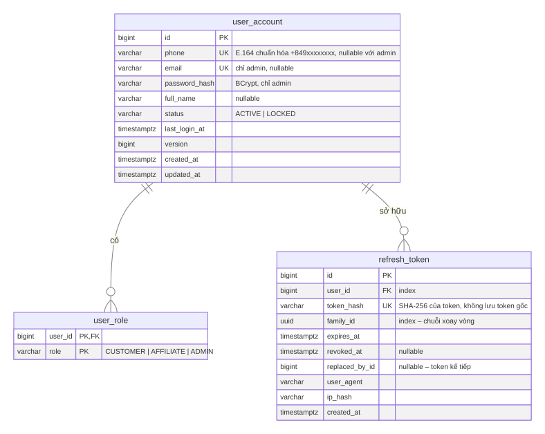

Mã nguồn Mermaid

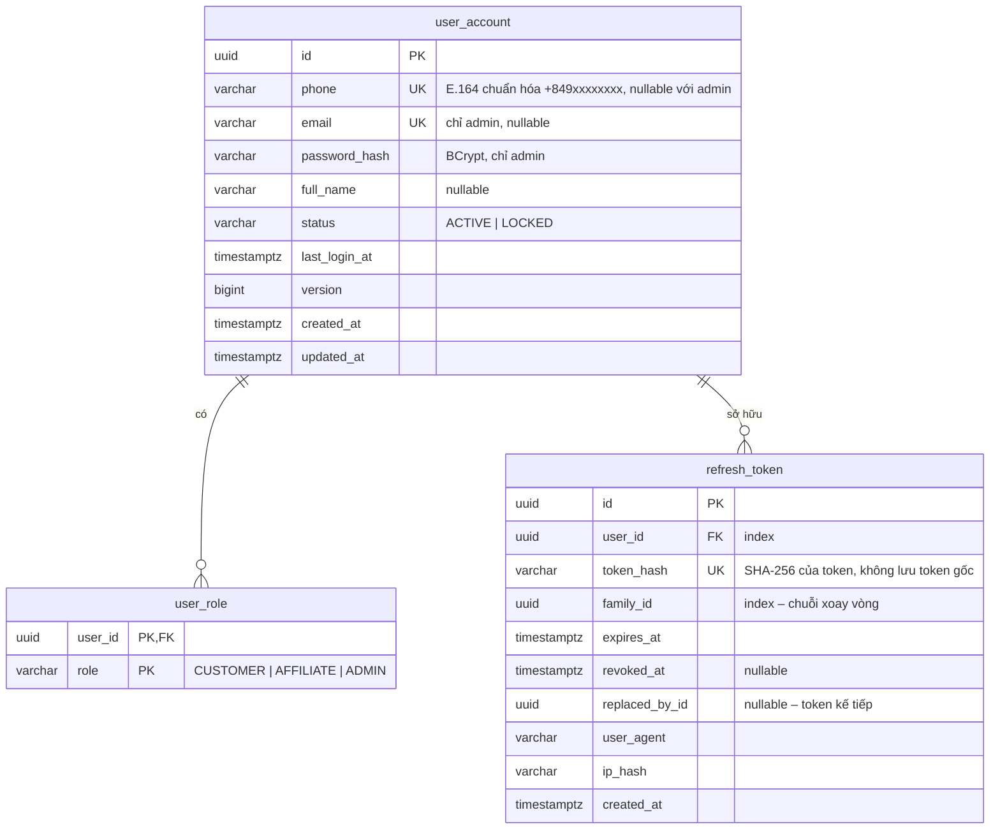

| Ràng buộc / index | Mục đích |
|---|---|
| `CHECK (phone IS NOT NULL OR email IS NOT NULL)` | Mỗi user có ít nhất 1 định danh |
| `idx_refresh_token_family (family_id)` | Thu hồi cả chuỗi khi phát hiện dùng lại token đã xoay |

**Redis (không phải bảng)** – identity dùng các key:

| Key | Giá trị | TTL |
|---|---|---|
| `otp:{purpose}:{phone}` | hash(OTP + pepper), `attempts` | 5 phút |
| `otp:lock:{phone}` | 1 | 15 phút (sau 5 lần sai) |
| `rl:otp:phone:{phone}` | bộ đếm | 10 phút (tối đa 3) |
| `rl:otp:ip:{ipHash}` | bộ đếm | 10 phút (tối đa 3) |

`purpose` = `LOGIN` | `BANK_CHANGE`.

---

## 2. Schema `catalog`


Mã nguồn Mermaid

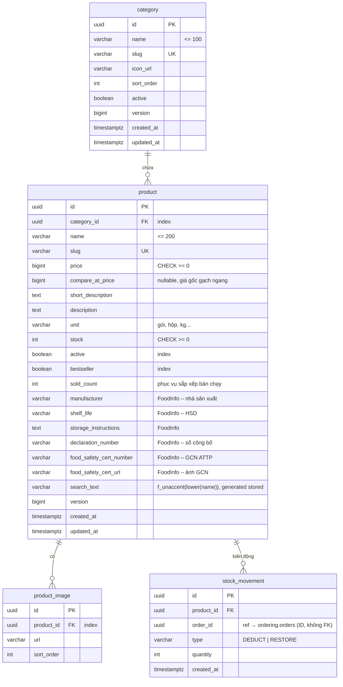

| Ràng buộc / index | Mục đích |
|---|---|
| `CREATE EXTENSION unaccent, pg_trgm` + hàm `immutable f_unaccent(text)` | Tìm kiếm không dấu |
| `idx_product_search_trgm GIN (search_text gin_trgm_ops)` | Tăng tốc `ILIKE '%...%'` |
| `idx_product_category_active (category_id, active)` | Lọc theo danh mục |
| `uq_stock_movement (order_id, product_id, type)` | **Idempotent**: listener chạy lại không trừ/hoàn kho 2 lần |
| `UPDATE product SET stock = stock - :q WHERE id = :id AND stock >= :q` | Trừ kho nguyên tử, không bán âm |

`stock_movement` thuộc aggregate `Product` (ghi qua `Product`/`InventoryService`), không có repository riêng.

---

## 3. Schema `ordering`

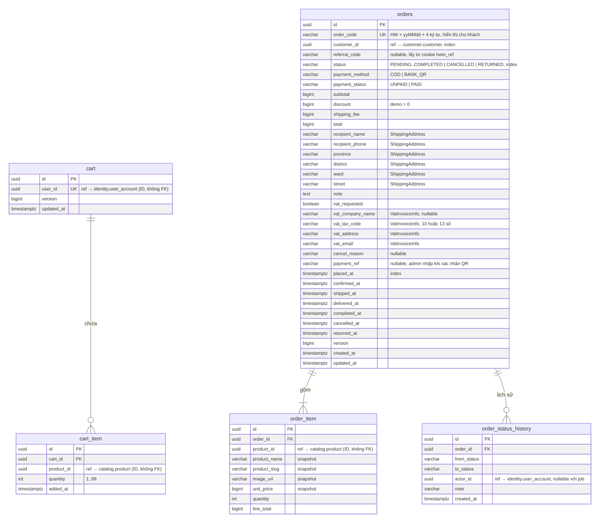

Mã nguồn Mermaid

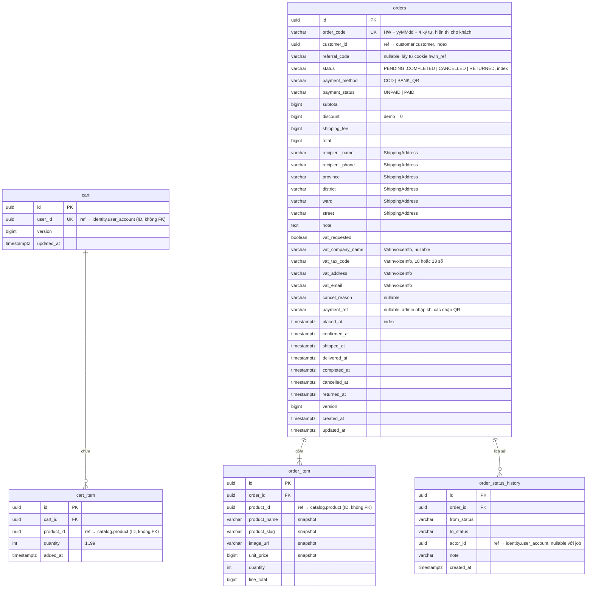

| Ràng buộc / index | Mục đích |
|---|---|
| Bảng tên `orders` (tránh từ khóa `order`) | |
| `uq_cart_item (cart_id, product_id)` | Mỗi sản phẩm 1 dòng trong giỏ |
| `idx_orders_customer (customer_id, placed_at desc)` | "Đơn của tôi" |
| `idx_orders_status (status, placed_at)` | Admin lọc đơn, job hoàn tất |
| `CHECK (total = subtotal - discount + shipping_fee)` | Bất biến tiền |

---

## 4. Schema `customer`

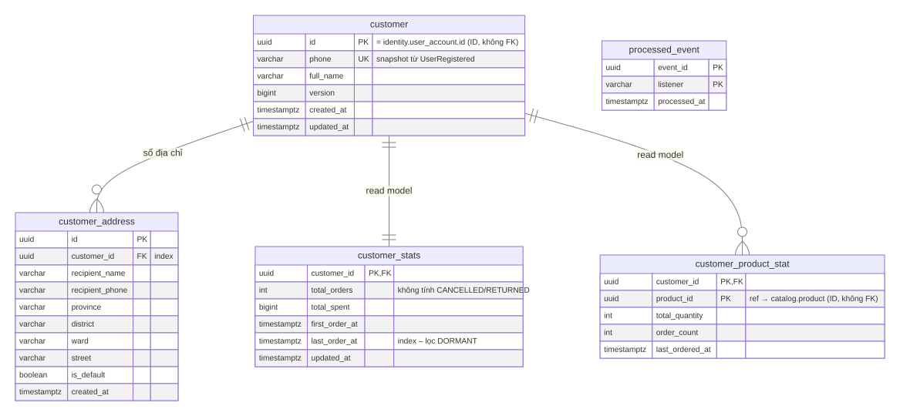

Mã nguồn Mermaid

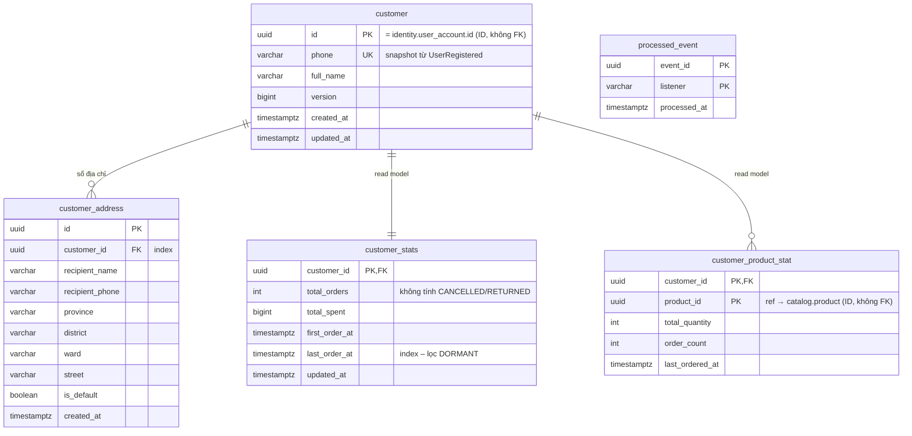

| Ràng buộc / index | Mục đích |
|---|---|
| (quy tắc trong aggregate `Customer`) | Đúng 1 địa chỉ mặc định – không dùng partial unique index vì Hibernate flush UPDATE theo thứ tự không xác định |
| `processed_event (event_id, listener)` | Listener cập nhật read model **idempotent** khi event được phát lại |
| Phân nhóm (`NEW` / `LOYAL` / `DORMANT`) | Tính lúc truy vấn từ `customer_stats` + ngưỡng `hwin.customer.*`, không lưu |

---

## 5. Schema `affiliate`

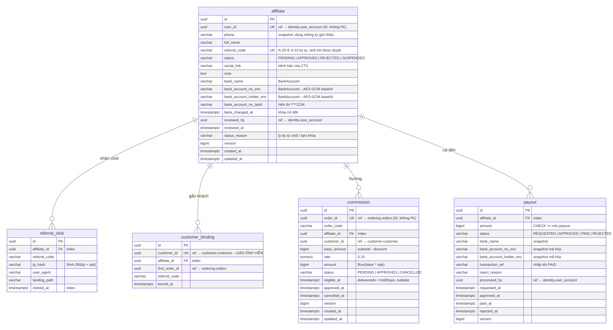

Mã nguồn Mermaid

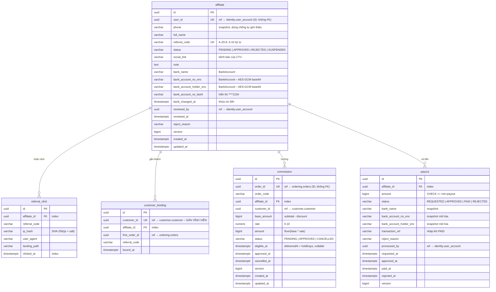

| Ràng buộc / index | Mục đích |
|---|---|
| `uq_customer_binding_customer (customer_id)` | **Gắn khách vĩnh viễn** – lần thứ 2 insert sẽ fail |
| `uq_commission_order (order_id)` | Mỗi đơn tối đa 1 hoa hồng; listener chạy lại an toàn |
| `uq_payout_open (affiliate_id) WHERE status IN ('REQUESTED','APPROVED')` | Mỗi CTV tối đa 1 yêu cầu rút đang mở → chống rút trùng do race |
| `idx_commission_status_eligible (status, eligible_at)` | Job duyệt hoa hồng |
| `idx_referral_click_affiliate_time (affiliate_id, clicked_at)` | Dashboard |
| Dedupe click 24h | Redis `click:{code}:{ipHash}` `SET NX EX 86400` (không phải unique DB) |

---

## 6. Schema `audit` và `public`

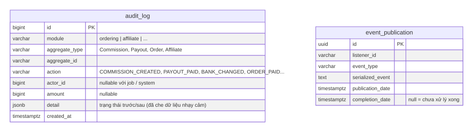

Mã nguồn Mermaid

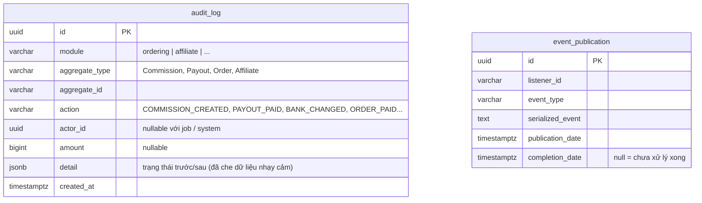

- `audit.audit_log` **chỉ ghi thêm**: trigger `BEFORE UPDATE OR DELETE … RAISE EXCEPTION`, và user ứng dụng chỉ có quyền `INSERT, SELECT`.
- `public.event_publication`: bảng chuẩn của Spring Modulith (cột chính xác theo phiên bản Modulith 2.x, tạo bằng Flyway).

---

## 7. Tổng hợp tham chiếu xuyên schema (chỉ ID, KHÔNG FK)

| Cột | Trỏ tới | Tính nhất quán đảm bảo bởi |
|---|---|---|
| `ordering.cart.user_id` | `identity.user_account.id` | JWT (chỉ user đã đăng nhập mới có cart) |
| `ordering.cart_item.product_id`, `order_item.product_id` | `catalog.product.id` | `ProductQueryService` khi thêm/đặt |
| `ordering.orders.customer_id` | `customer.customer.id` (= userId) | JWT |
| `catalog.stock_movement.order_id` | `ordering.orders.id` | Event `OrderPlaced/Cancelled/Returned` |
| `customer.customer.id` | `identity.user_account.id` | Event `UserRegistered` |
| `customer.customer_product_stat.product_id` | `catalog.product.id` | Event `OrderPlaced` |
| `affiliate.affiliate.user_id`, `reviewed_by`, `payout.processed_by` | `identity.user_account.id` | JWT |
| `affiliate.customer_binding.customer_id`, `commission.customer_id` | `customer.customer.id` | Event `OrderPlaced` |
| `affiliate.commission.order_id`, `customer_binding.first_order_id` | `ordering.orders.id` | Event `OrderPlaced` |
| `audit.audit_log.aggregate_id`, `actor_id` | nhiều bảng | Ghi bởi service |
