# 03 – Sơ đồ tuần tự

Ký hiệu chung:

- `FE` = Next.js (trình duyệt hoặc server SSR). Mọi lời gọi `/api/*` đi qua rewrite của Next.js tới Spring Boot nên cookie là first-party.
- Mũi tên nét đứt `-->>` từ `Bus` = event nội bộ phát qua `ApplicationEventPublisher`, listener `@ApplicationModuleListener` chạy **async, sau commit, transaction mới**; Spring Modulith lưu vào `event_publication` để retry.

---

## a. Đăng nhập OTP + cấp và xoay vòng JWT

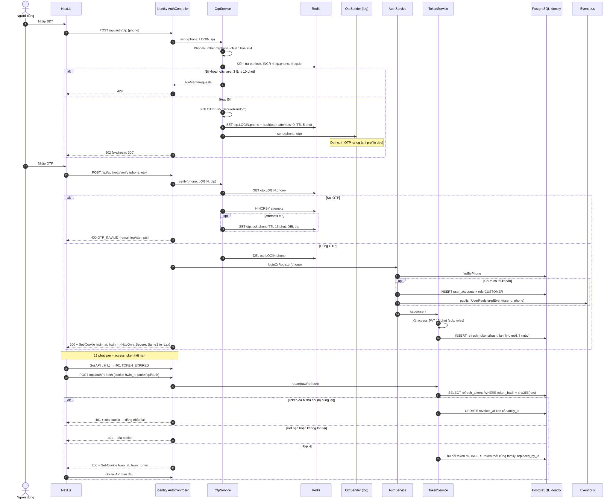

Mã nguồn Mermaid

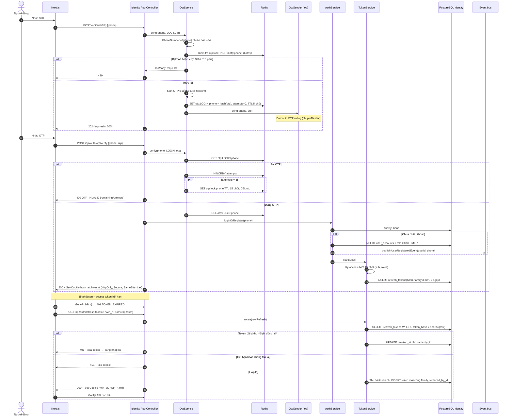

---

## b. Ghi nhận click link CTV (?ref)

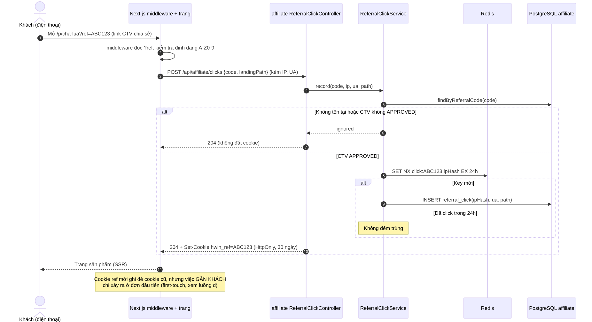

Mã nguồn Mermaid

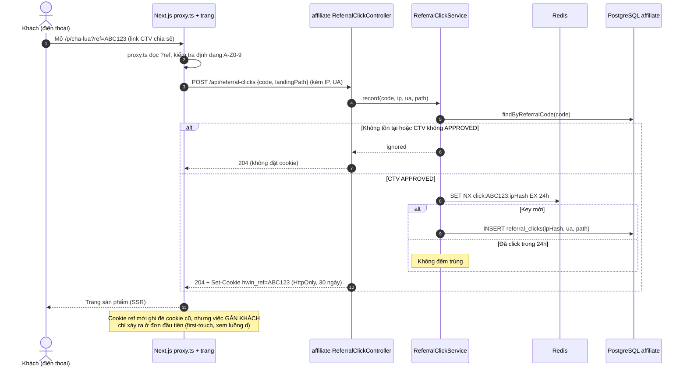

---

## c. Thanh toán và đặt hàng (kèm tạo tài khoản bằng OTP)

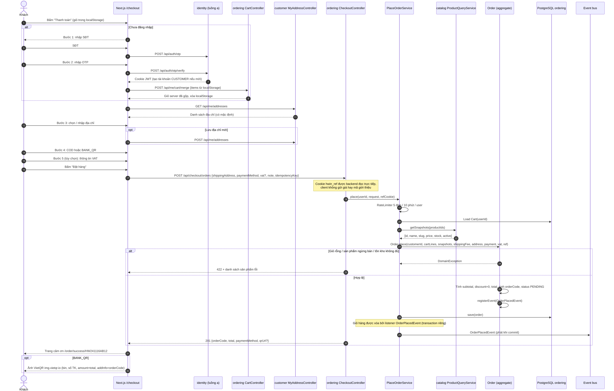

Mã nguồn Mermaid

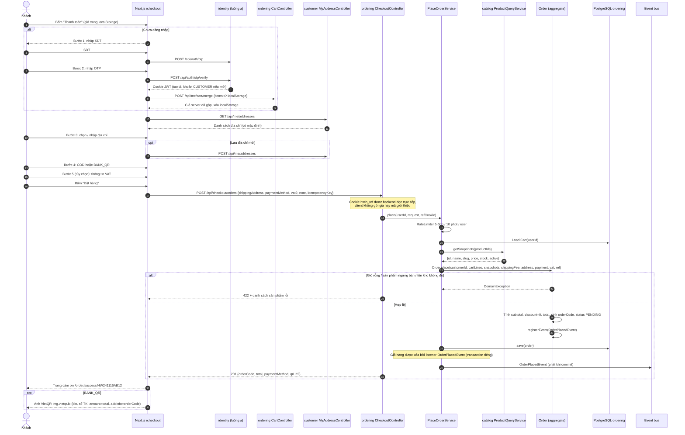

---

## d. Xử lý event sau OrderPlacedEvent

Mỗi listener là một transaction riêng, chỉ sửa **một** aggregate, idempotent.

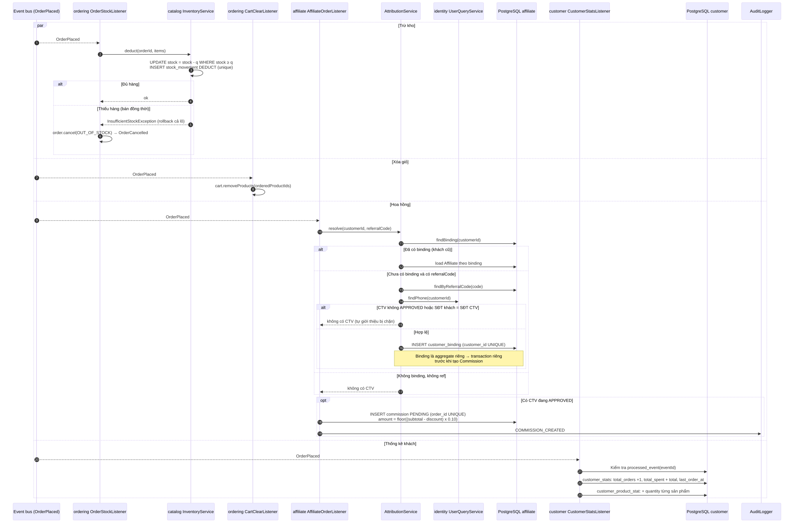

Mã nguồn Mermaid

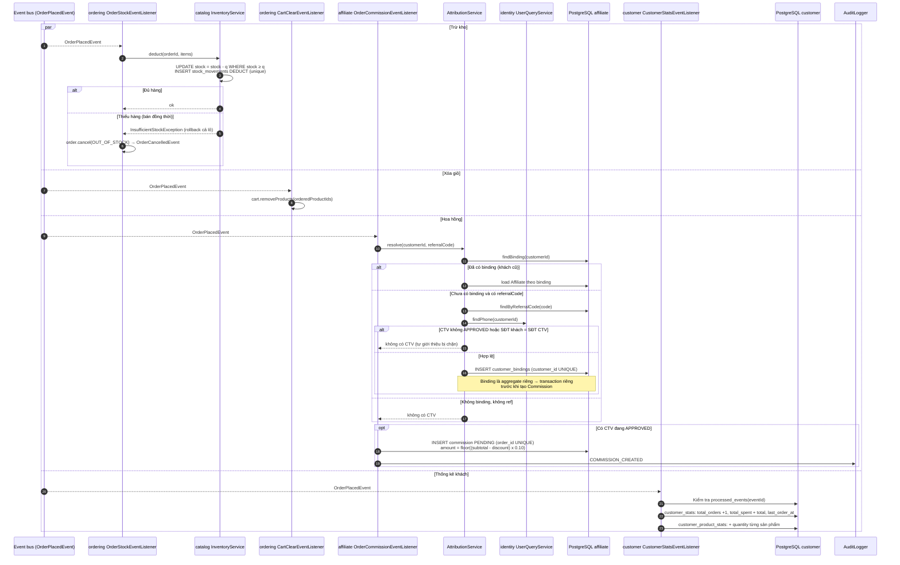

> Khách đã có binding nhưng CTV đó bị `SUSPENDED` → **không** tạo hoa hồng và **không** chuyển khách sang CTV mới (binding vĩnh viễn).

---

## e. Giao thành công → job duyệt hoa hồng sau 7 ngày

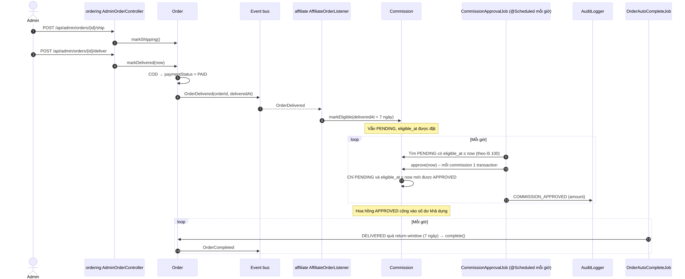

Mã nguồn Mermaid

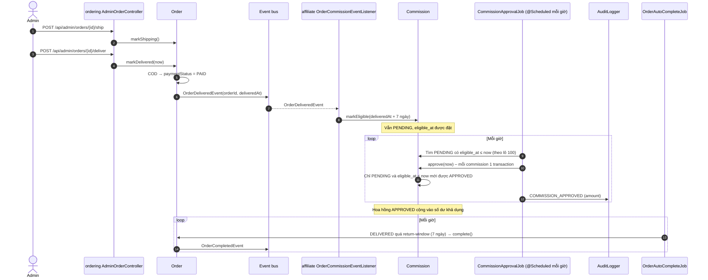

---

## f. Hủy / hoàn đơn → hoàn kho + hủy hoa hồng

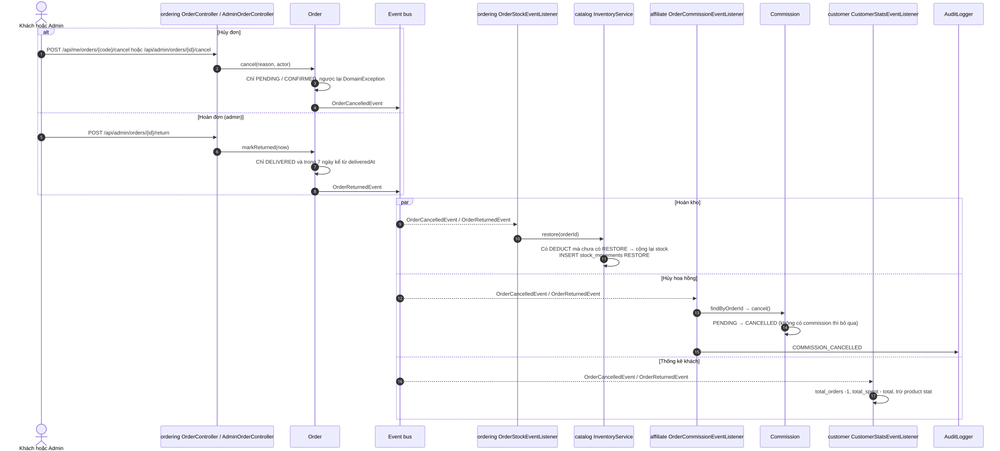

Mã nguồn Mermaid

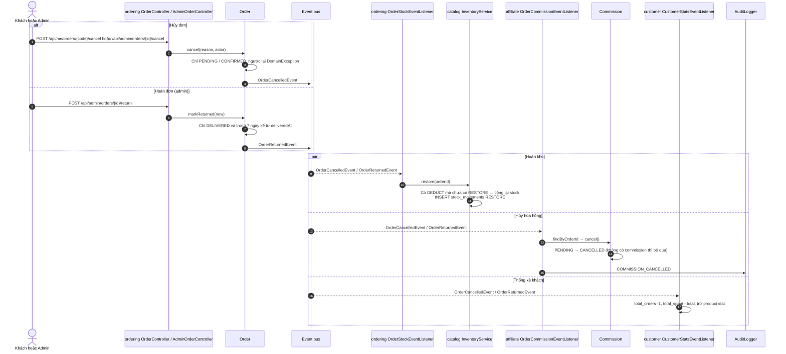

---

## g. CTV yêu cầu rút tiền → admin duyệt → chi trả

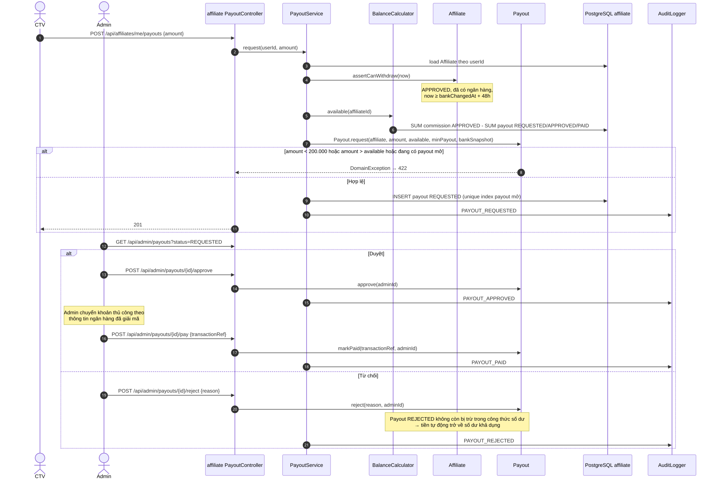

Mã nguồn Mermaid

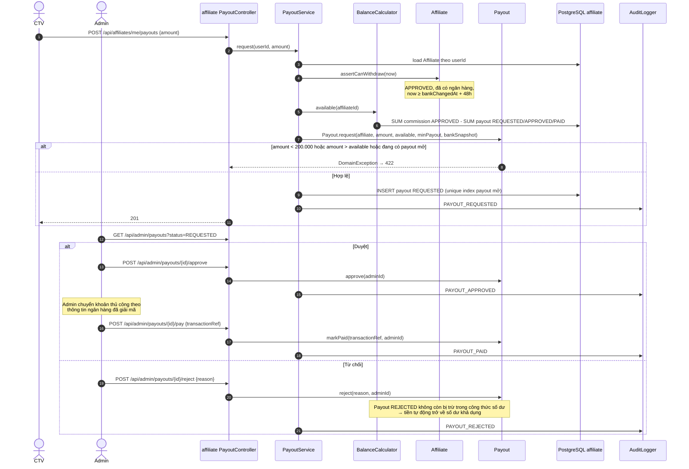

**Đổi tài khoản ngân hàng** (liên quan): `POST /api/affiliates/me/bank-account/otp` → OTP purpose `BANK_CHANGE` gửi tới SĐT CTV → `PUT /api/affiliates/me/bank-account {bankName, accountNo, holder, otp}` → `OtpService.verify` → `affiliate.changeBankAccount(encrypted, now)` đặt `bankChangedAt = now` (lần đầu thiết lập không khóa) → audit `BANK_CHANGED`.

---

## h. Mua lại đơn cũ

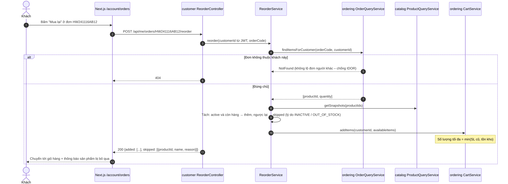

Mã nguồn Mermaid

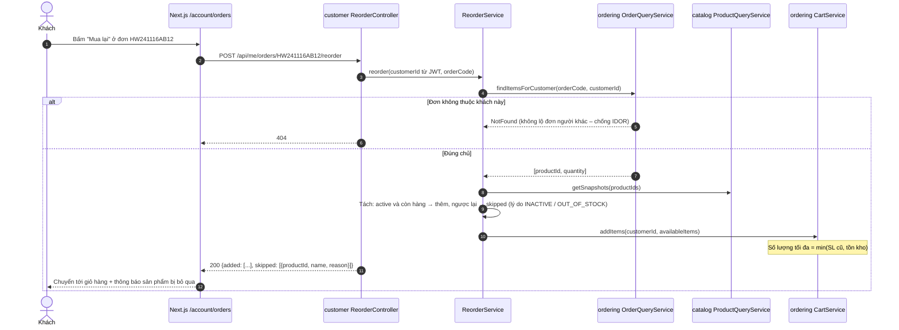

