# 04 – Vòng đời trạng thái và quy trình nghiệp vụ

Mỗi chuyển trạng thái là **một method của aggregate root**. Chuyển sai quy tắc → `DomainException` (HTTP 409 `INVALID_STATE_TRANSITION`).

---

## 1. Order


Mã nguồn Mermaid

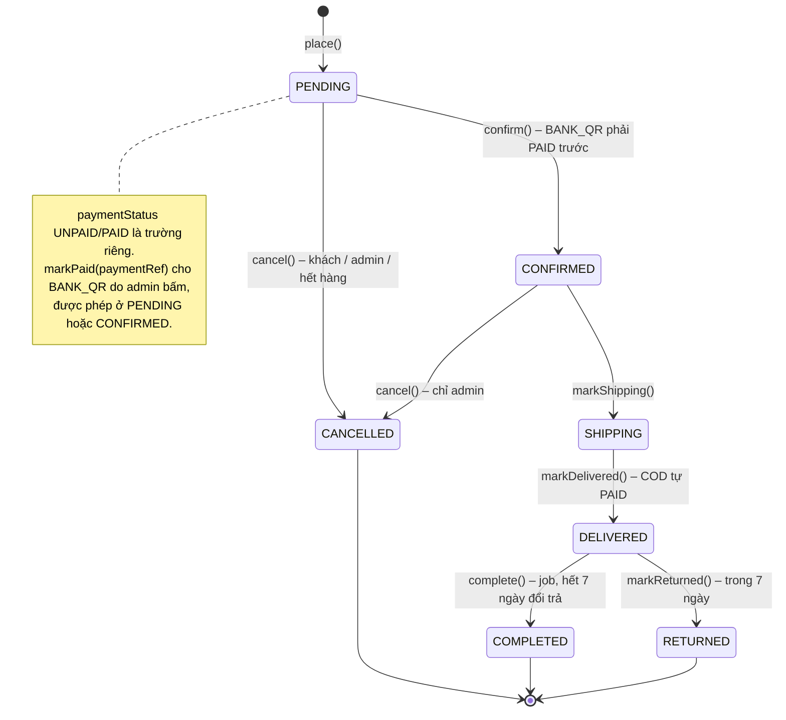

| Method | Từ | Sang | Event | Ai gọi |
|---|---|---|---|---|
| `place()` | – | PENDING | `OrderPlacedEvent` | Khách |
| `markPaid(ref)` | PENDING, CONFIRMED (UNPAID) | (payment PAID) | – (audit `ORDER_PAID`) | Admin |
| `confirm()` | PENDING | CONFIRMED | `OrderConfirmedEvent` | Admin |
| `cancel(reason)` | PENDING (khách), PENDING/CONFIRMED (admin, system) | CANCELLED | `OrderCancelledEvent` | Khách / Admin / `OrderStockEventListener` |
| `markShipping()` | CONFIRMED | SHIPPING | – | Admin |
| `markDelivered()` | SHIPPING | DELIVERED | `OrderDeliveredEvent` | Admin |
| `markReturned()` | DELIVERED (≤ 7 ngày) | RETURNED | `OrderReturnedEvent` | Admin |
| `complete()` | DELIVERED (> 7 ngày) | COMPLETED | `OrderCompletedEvent` | Job |

> Khách chỉ tự hủy được khi đơn còn `PENDING`; khi đã `CONFIRMED` phải liên hệ shop (admin hủy).

---

## 2. Affiliate


Mã nguồn Mermaid

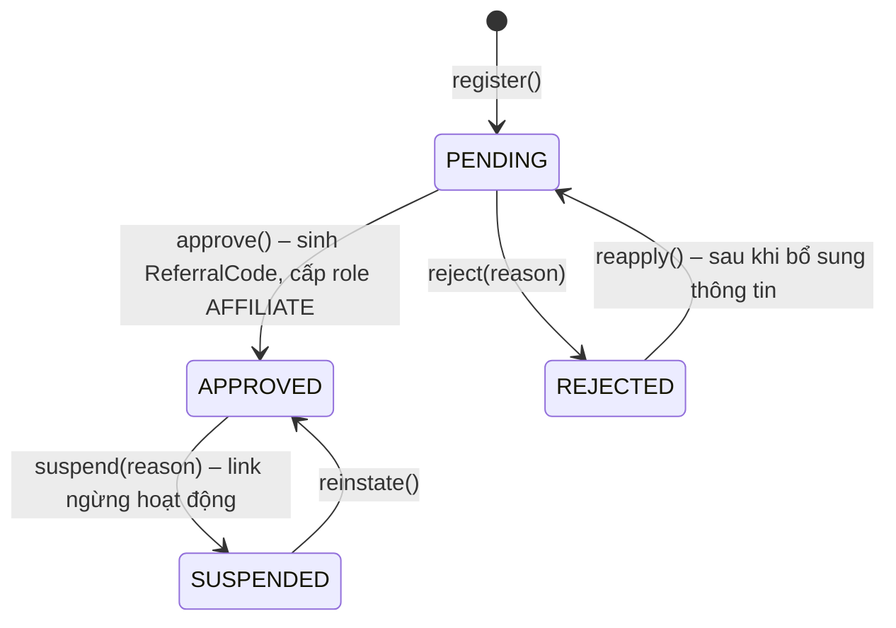

| Trạng thái | Link `?ref` | Hoa hồng mới | Rút tiền số dư cũ |
|---|---|---|---|
| PENDING | Không | Không | – |
| APPROVED | **Có** | **Có** | Có |
| SUSPENDED | Không (click bị bỏ qua) | Không | **Không** (chờ admin xử lý) |
| REJECTED | Không | Không | – |

---

## 3. Commission


Mã nguồn Mermaid

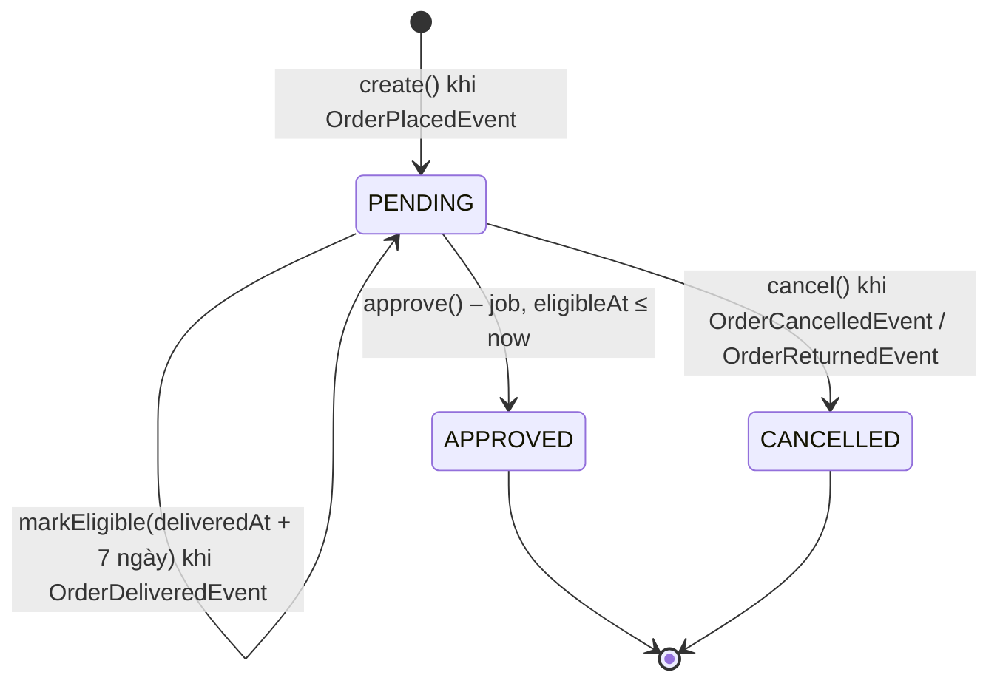

- `approve()` ném `DomainException` nếu `eligibleAt == null` (đơn chưa giao) hoặc chưa đủ 7 ngày.
- Không có trạng thái PAID ở Commission: việc chi trả được theo dõi ở `Payout`; số dư được **tính**, không cộng trừ trực tiếp → một transaction chỉ sửa một aggregate.
- Vì cửa sổ đổi trả (7 ngày) = thời gian giữ (7 ngày), một commission APPROVED không thể bị hủy do trả hàng.

---

## 4. Payout


Mã nguồn Mermaid

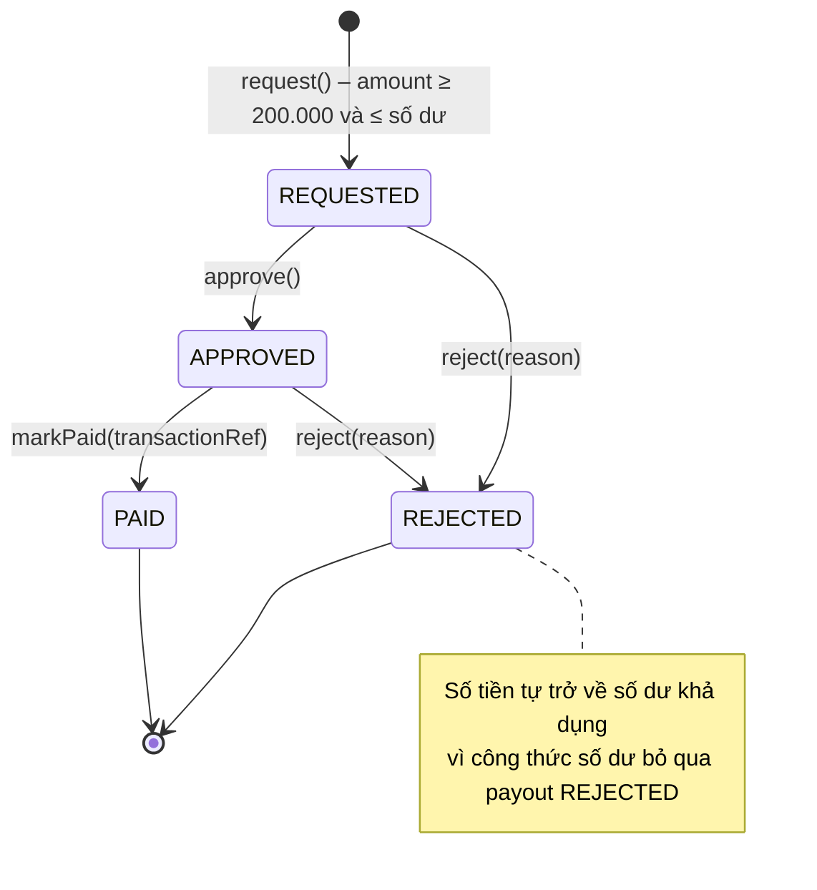

---

## 5. Quy trình đăng ký và duyệt CTV


Mã nguồn Mermaid

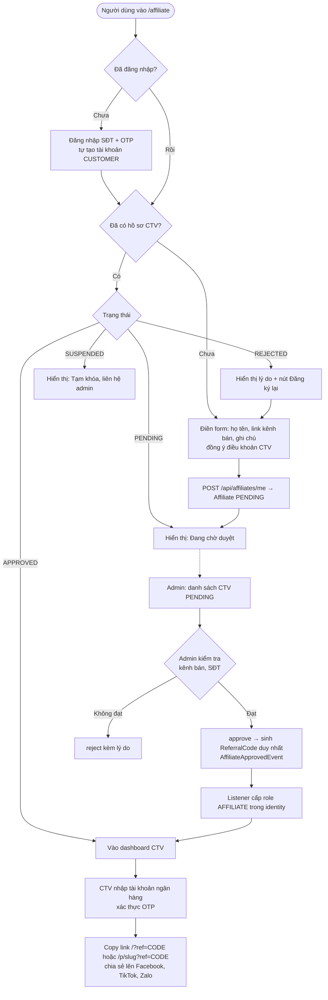

---

## 6. Quy trình xử lý đơn hằng ngày của admin


Mã nguồn Mermaid

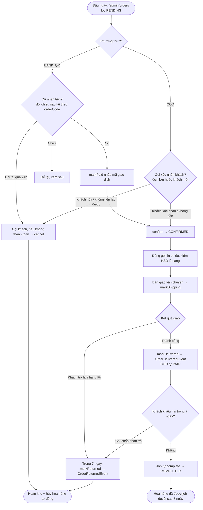

---

## 7. Quy trình đối soát và chi trả hoa hồng


Mã nguồn Mermaid

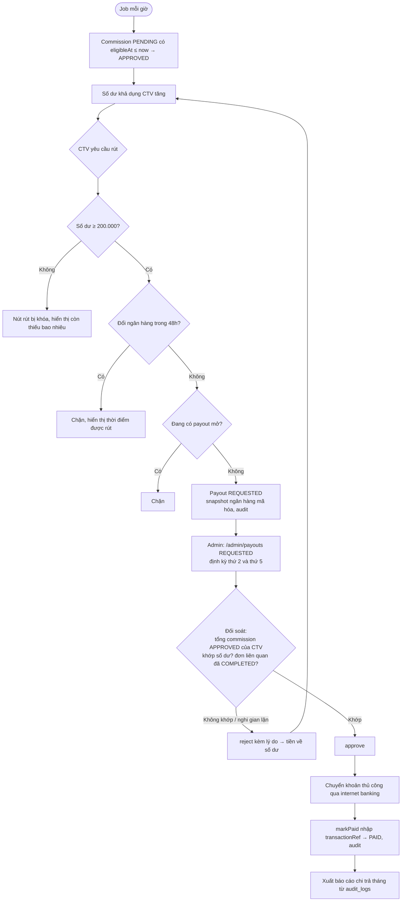

